# Atelier OAuth 2.0 / OpenID Connect : React + Spring Boot + Keycloak

Application de gestion de demandes sécurisée par **Keycloak** (OAuth 2.0 / OpenID Connect) :

- **Frontend** : React + Vite + `keycloak-js` (flux Authorization Code avec PKCE), port 5173
- **Backend** : Spring Boot 3.5 (Resource Server JWT), port 8081
- **Serveur d'identité** : Keycloak 26.8.1 (Docker), port 8080, realm `enset-realm`
- **Rôles** : `USER` (crée et consulte ses demandes), `ADMIN` (consulte toutes les demandes, valide ou refuse)

Réalisé par **JABAH Salma** (CCN3), ENSET Mohammedia, module Sécurité des systèmes distribués.

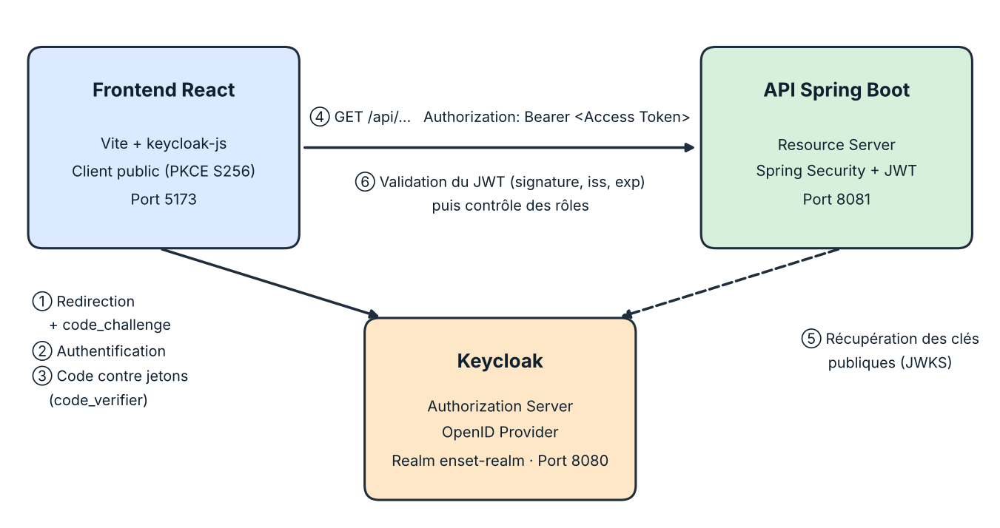

## Structure du dépôt

```
atelier-oauth2/
├── docker-compose.yml        # Keycloak
├── demandes-api/             # API Spring Boot (+ tests de sécurité)
├── demandes-front/           # Frontend React
├── postman/                  # Collection Postman (tests 4 à 7)
└── docs/                     # Rapport, schémas et captures d'écran
```

## Démarrage

### 1. Keycloak
Docker Desktop doit être lancé.
```bash
docker compose up -d
```
Console d'administration : http://localhost:8080 (`admin` / `admin`, usage local uniquement).

Configuration (détaillée dans le rapport) : realm `enset-realm`, client public `react-client`
(Standard flow uniquement, Require PKCE activé, redirect URI `http://localhost:5173/*`,
web origin `http://localhost:5173`), realm roles `USER` et `ADMIN`, utilisateurs `alice` (USER) et `bob` (ADMIN).

### 2. Backend
```bash
cd demandes-api
mvn spring-boot:run
```
(ou lancer la classe `DemandesApiApplication` depuis l'éditeur). Tests : `mvn test`.

### 3. Frontend
```bash
cd demandes-front
npm install
npm run dev
```
Ouvrir http://localhost:5173 : redirection vers la page de connexion Keycloak.

## API

| Méthode | URL | Accès |
|---|---|---|
| GET | `/api/public` | public |
| GET | `/api/profil` | authentifié |
| GET, POST | `/api/demandes` | USER ou ADMIN |
| GET | `/api/admin/demandes` | ADMIN |
| PATCH | `/api/admin/demandes/{id}` | ADMIN (`EN_ATTENTE`, `VALIDEE`, `REFUSEE`) |

## Captures d'écran

### Keycloak
| | |
|---|---|
| 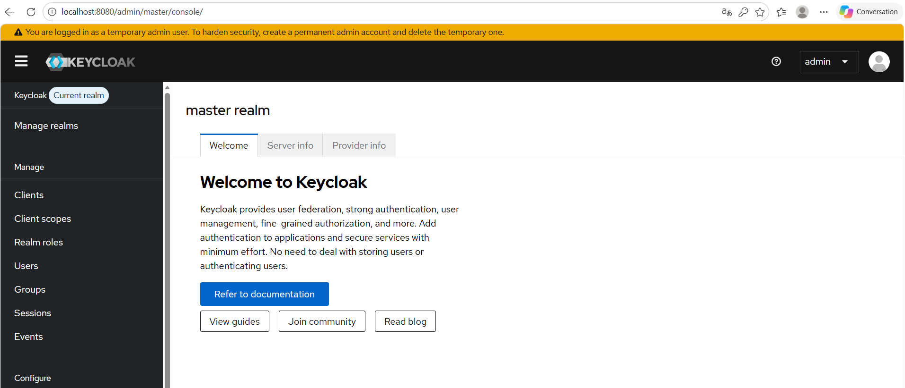 Console d'administration | 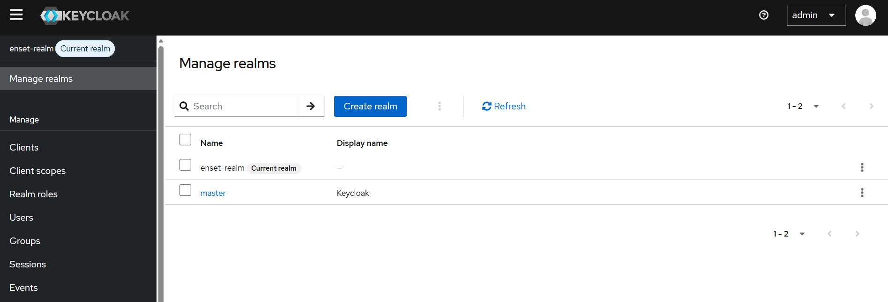 Realm `enset-realm` |
| 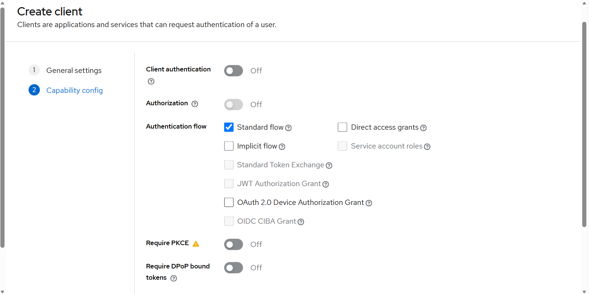 Configuration du client | 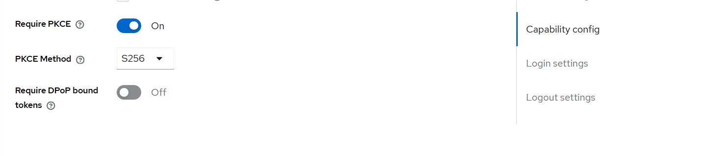 Require PKCE |
| 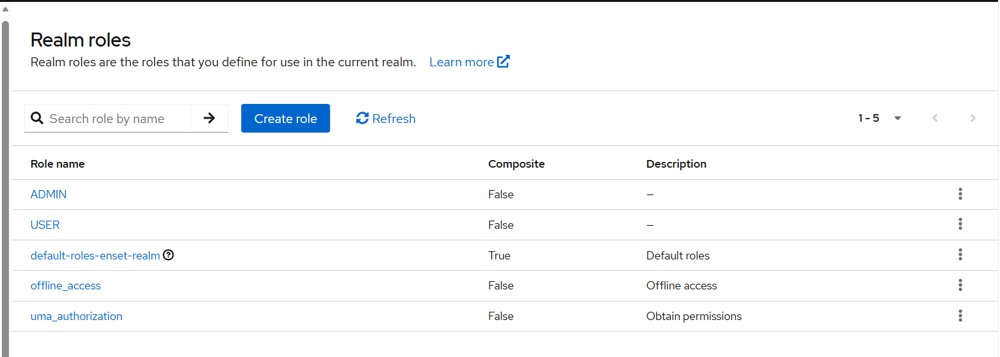 Realm roles | 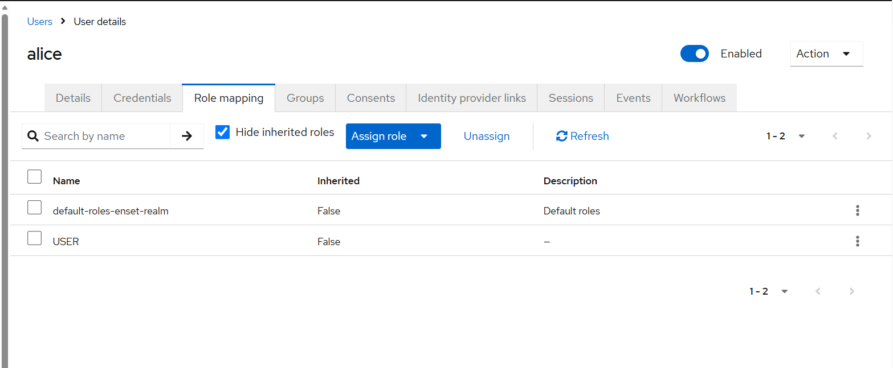 Rôles de alice |

### Application
| | |
|---|---|
| 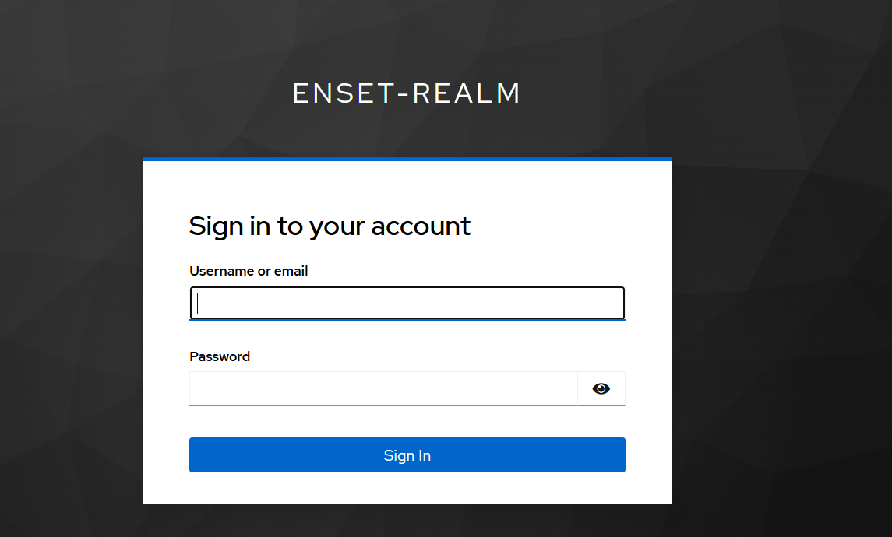 Redirection vers Keycloak | 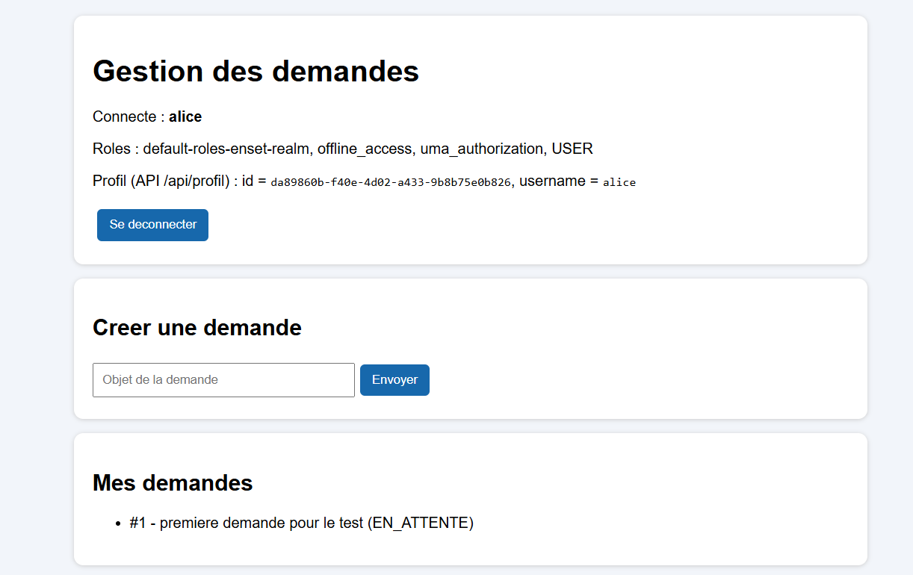 Interface de alice (USER) |
| 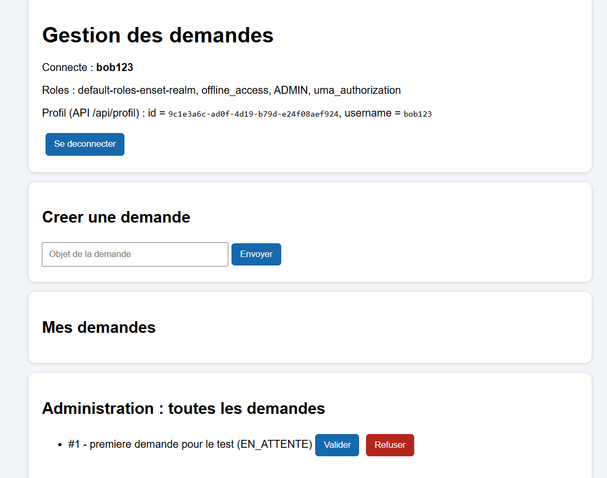 Interface de bob (ADMIN) | 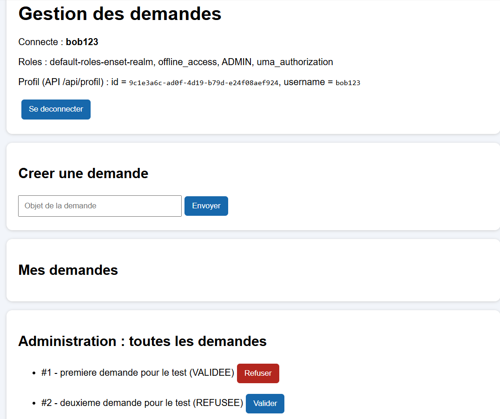 Validation / refus d'une demande |

### Tests de sécurité
| Test | Résultat |
|---|---|
| Sans token | 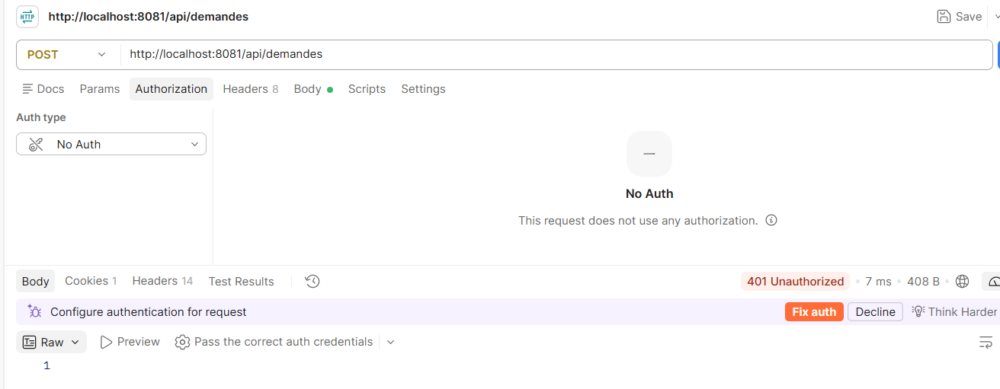 |
| USER sur l'API admin (403) | 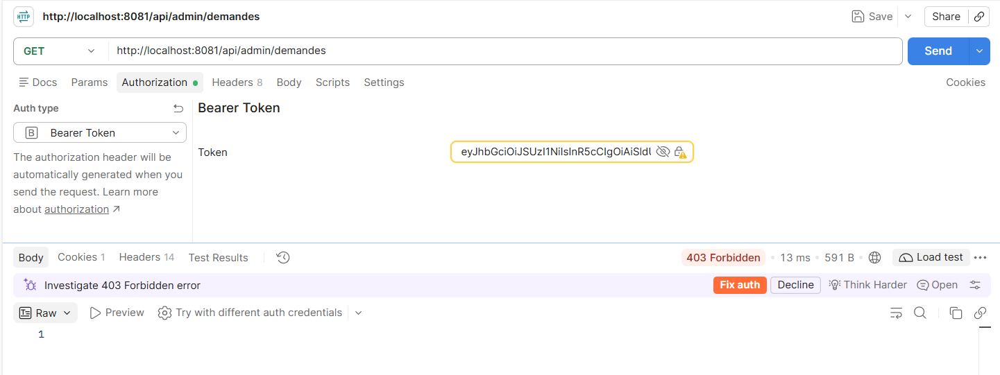 |
| ADMIN sur l'API admin (200) | 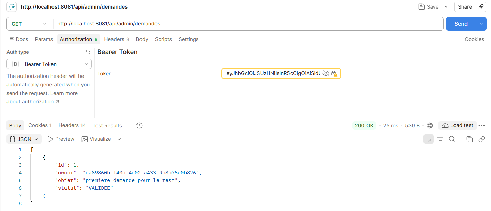 |
| Token altéré (401) | 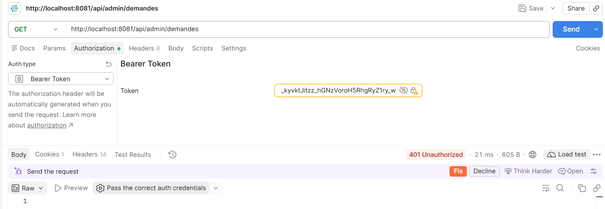 |

Toutes les captures figurent dans [`docs/screenshots`](docs/screenshots) et le rapport complet dans [`docs`](docs).

## Sécurité
Les identifiants de ce dépôt (`admin/admin`, utilisateurs de test) et le mode `start-dev` de Keycloak sont
réservés à un usage local et pédagogique. Aucun token actif ni secret n'est versionné.
